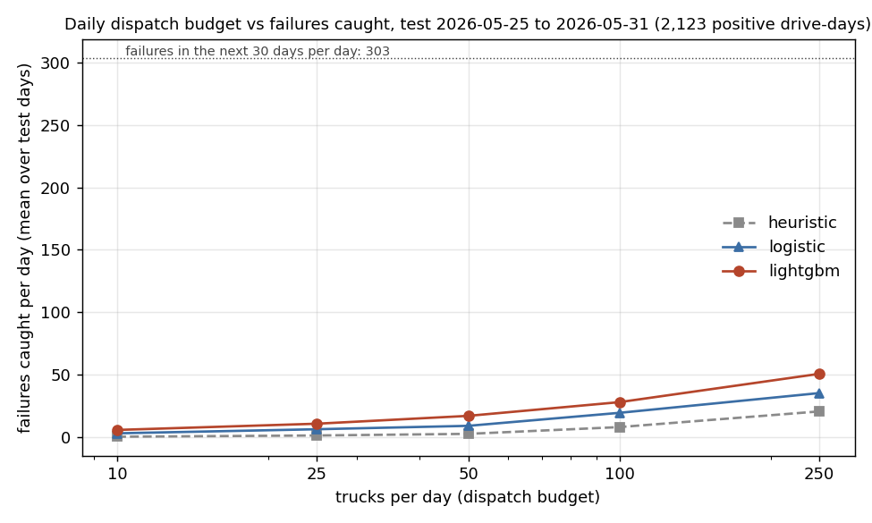
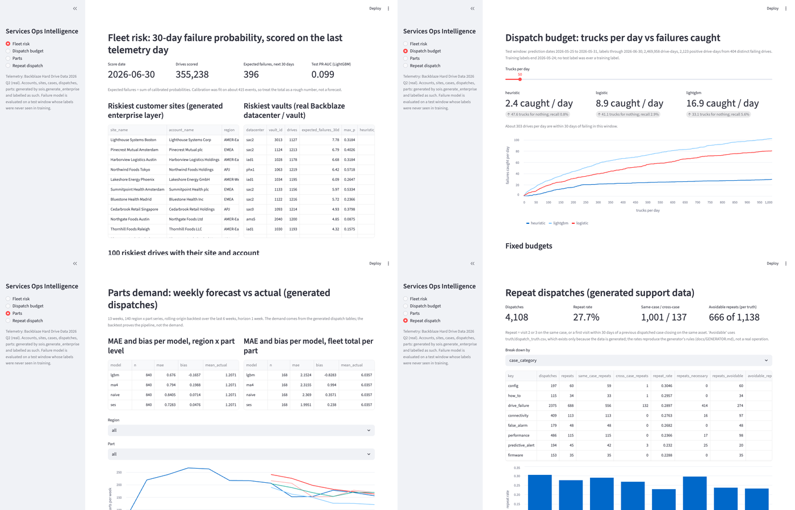

# services-ops-intelligence

Project 1 of 3: predictive support and parts forecasting for an installed
base of hardware, built the way a Services Operations team would use it.

## Why this exists

On October 6, 2026 Dell announced the next release of the Dell AI Data
Platform, and Arthur Lewis (President, Infrastructure Solutions Group) put the
problem in one line: "In many cases, the model is not the next constraint, the
data is." The platform's answer is a data layer that engines and agents share,
an enterprise knowledge graph built from metadata, lineage and query history,
and knowledge agents that get trusted, permissioned context instead of raw
tables. This repository is the data-science end of a three-part portfolio
built on that framing: one small enterprise whose systems disagree the way
real ones do, real hardware telemetry underneath it, and models whose output
is an operations decision rather than an accuracy score.

The three repositories:

1. `services-ops-intelligence` (this one): the shared data foundation and the
   Services Operations analyses.
2. `enterprise-knowledge-graph` (planned): ontology, entity resolution,
   lineage graph and text-to-Cypher over the same enterprise.
3. `knowledge-agents-pilot` (planned): governed agents on NVIDIA Auto
   Ontology, Elasticsearch and MCP, with evaluations and program artifacts.

## What is real and what is generated

| Data | Source | Status |
|---|---|---|
| `telemetry_daily` (one row per drive per day: SMART attributes, failure flag, datacenter, vault, pod) | Backblaze Hard Drive Data, 2026 Q2, loaded as-is | Real |
| `drive_model`, `telemetry_drive_summary` | Derived from the telemetry by `sois.load_telemetry` | Real (derived) |
| `account`, `site`, `contact` (CRM) | `sois.generate_enterprise`, seeded | Generated |
| `product`, `order`, `order_line`, `installed_asset` (ERP) | same; `installed_asset.serial_number` is the real drive serial, so every asset is a real drive with real telemetry | Generated, joined to real |
| `part`, `supplier`, `part_supplier`, `inventory` (supply chain) | same | Generated |
| `case`, `dispatch`, `dispatch_part`, `technician`, `runbook` (support) | same; case timing is tied to real failure dates (cases cluster after a drive's failure flag, some open before it) | Generated, timed by real failures |
| `data_product`, `job`, `lineage`, `query_log` (metadata) | same | Generated |
| `truth/` | ground truth behind every piece of generated mess | Generated |

The generated data is deliberately dirty in documented ways (three spellings
of the same customer, duplicate ids, two date formats, two definitions of
"failure", null warranties, vendor-prefixed serials). Every rule is listed in
[docs/MESS_RULES.md](docs/MESS_RULES.md), every table's construction in
[docs/GENERATOR.md](docs/GENERATOR.md), and every rule has ground truth under
`truth/` so any answer can be checked. The generator is seeded; the same seed
gives byte-identical output, and `truth/generator_manifest.json` carries the
hashes.

Why generated data is acceptable here: a hiring manager cares that the problem
shape matches theirs, and known ground truth is what makes honest evaluation
possible. The telemetry, which is what the failure model learns from, is real.

## Results (v0.1, measured 2026-10-17)

Everything below was printed by code in this repository (`make analyses`) and
is in `reports/` with the numbers it printed. The memo for an operations
reader is [docs/memo.md](docs/memo.md).

### 30-day failure risk as a dispatch-budget decision (real telemetry)

`sois.failure_model`. Label: the drive has `failure = 1` on any day in
(t, t + 30]. Features use only days <= t. Time split with no label leakage:
train prediction dates 2026-04-08 to 2026-04-24 (labels through 05-24), test
prediction dates 2026-05-25 to 2026-05-31 (labels through 06-30), so no test
label was ever a training label; nothing was tuned on the test window. Fit
rows have negatives downsampled to 10%; 20% of drives are held out of the fit
and calibrate the probabilities (Platt) on the last five training dates. Test:
2,469,958 drive-days, 2,123 positive drive-days, 404 distinct failing drives.

| Ranking | PR-AUC | Recall in top 0.1% | Recall in top 1% | Brier (calibrated) |
|---|---:|---:|---:|---:|
| Backblaze rule (any of SMART 5/187/188/197/198 > 0) | 0.018 | 7% | 30% | n/a |
| Logistic regression | 0.057 | 15% | 44% | 0.000913 |
| LightGBM | 0.099 | 21% | 50% | 0.000816 |

Base rate 0.00086 (a random ranking scores PR-AUC 0.0009); a constant
predictor scores Brier 0.000859, so the calibrated LightGBM beats it only
slightly and the reliability table (`reports/reliability.csv`) shows the top
decile predicting 0.81% against an observed 0.61%. Calibration rests on 415
events and the test on 404 failing drives: expect these numbers to move by a
few points with a different window.

Dispatch budget on the test window (per day, mean over 7 days; about 303
drives a day are within 30 days of failing; full table in
`reports/dispatch_budget.csv`):

| Trucks per day | Rule caught | Rule for nothing | Logistic caught | LightGBM caught | LightGBM for nothing | LightGBM recall |
|---:|---:|---:|---:|---:|---:|---:|
| 10 | 0.1 | 9.9 | 2.9 | 5.6 | 4.4 | 1.8% |
| 25 | 1.1 | 23.9 | 6.1 | 10.6 | 14.4 | 3.5% |
| 50 | 2.4 | 47.6 | 8.9 | 16.9 | 33.1 | 5.6% |
| 100 | 7.9 | 92.1 | 19.3 | 27.9 | 72.1 | 9.2% |
| 250 | 20.4 | 229.6 | 35.1 | 50.6 | 199.4 | 16.7% |



The rule flags 29,930 drives a day (8.5% of the fleet); dispatching to all of
them would catch 67% of failures at 0.7% precision. At any budget an
operation could run, the model catches several times what the rule catches,
and still under 10% of the month's failures with 100 trucks a day: most
failures show nothing in the counters first. Top features by gain: 7-day max
of pending sectors (46%), reallocated sectors, drive model, power-on hours.

### Parts demand forecast (generated dispatches)

`sois.parts_forecast`. Weekly units per region and part from `dispatch_part`;
13 weeks exist, so the backtest is weekly (rolling origin over the last 6
weeks, horizon 1), not monthly as first planned. MAE per region x part series
(mean week 1.2 units): naive 0.84, 4-week average 0.79, exponential smoothing
0.73, pooled LightGBM 0.68 (bias -0.17). Summed to fleet totals per part:
naive 2.37, SES 2.00, LightGBM 2.15. The demand is generated, so this proves
the pipeline and the comparison, not the demand.

### Repeat dispatches (generated support tables)

`sois.repeat_dispatch`. Repeat = visit 2 or 3 on the same case, or a first
visit within 30 days of a previous dispatched case closing on the same asset.
4,108 dispatches, 1,138 repeats (27.7%: 1,001 same-case, 137 cross-case).
Against `truth/dispatch_truth.csv`: 472 necessary, 666 avoidable; the
same-case definition matches the truth flag on every row. The rates reproduce
the generator's rules (docs/GENERATOR.md); they are not a finding about any
real operation.

### Dashboard, memo, Colab

`make dashboard` runs the Streamlit app over `reports/` only (no data needed).



- Memo for an operations leader: [docs/memo.md](docs/memo.md).
- Colab notebook with the feature pipeline in pandas and `cudf.pandas`:
  [open in Colab](https://colab.research.google.com/github/arnavchawla26/services-ops-intelligence/blob/main/notebooks/feature_pipeline_cudf.ipynb),
  steps in [docs/COLAB.md](docs/COLAB.md). Measured on a Colab T4 (30 days, 10.4M rows): the feature step ran 5.1x faster on cudf.pandas (0.79 s vs 4.06 s); end to end 1.03x because CSV reading dominates. Table and caveats in docs/COLAB.md.

## Analyses: done and pending

- Done: 30-day failure model with a leak-free time split, calibrated
  probabilities, dispatch-budget table and chart.
- Done: parts demand forecast by region and part, backtested weekly (not
  monthly: 13 weeks of data) against naive, moving-average and smoothing
  baselines.
- Done: repeat-dispatch analysis by product, category, region, technician
  and supplier, checked against the truth flags.
- Pending: case deflection candidates (runbook text match scored against
  `truth/case_truth.csv`).
- Done: Streamlit dashboard; two-page memo (one memo covering all three
  analyses, not one per analysis).
- Done: the Colab cuDF notebook, run on a T4 on 2026-10-17 (5.1x on the feature step, 1.03x end to end; see docs/COLAB.md).

## What exists today

- `scripts/download_backblaze.sh`: fetch, verify and extract the 2026 Q2 data.
- `src/sois/load_telemetry.py`: daily CSVs to partitioned Parquet with DuckDB,
  plus per-drive and per-model summaries. Handles SMART columns that come and
  go between files.
- `src/sois/generate_enterprise.py`: the seeded enterprise generator and its
  ground truth.
- `docker-compose.yml`, `sql/schema.sql`, `src/sois/load_postgres.py`:
  Postgres 16 with the generated tables, the drive summary, and the last 30
  days of daily telemetry (the full quarter stays in Parquet).
- `src/sois/failure_model.py`, `parts_forecast.py`, `repeat_dispatch.py`: the
  three analyses, each a CLI writing to `reports/` (`make models`, `make
  parts`, `make repeat`). The failure model reads the Parquet with DuckDB one
  prediction date at a time and runs in about 30 seconds on a laptop.
- `app/dashboard.py`, `scripts/screenshot_dashboard.py`: the dashboard and its
  headless screenshot.
- `tests/`: 39 tests on hand-made synthetic fixtures, covering loader counts
  and schema drift, generator determinism and every mess rule, the DDL, a live
  Postgres load when a database is listening, and for the analyses: features
  use only days <= t, labels match the window, the split refuses a leaking
  configuration, budget arithmetic, mixed-format timestamp parsing, the repeat
  definitions, and end-to-end runs on a 60-day synthetic fleet.

## Setup

Requirements: Python 3.13, [uv](https://docs.astral.sh/uv/), Docker (for
Postgres), about 15 GB of disk for the raw data. The analyses need the
Parquet and the generated tables; the dashboard and the tests do not.

```
uv sync                                  # environment from uv.lock (pinned)
uv run pytest                            # fixture-only, no data needed
bash scripts/download_backblaze.sh       # asks before fetching 2.1 GB
make load                                # CSV -> data/parquet (DuckDB)
make generate                            # enterprise tables -> data/enterprise, truth/
cp .env.example .env && make db-up       # Postgres 16 in Docker
make postgres                            # schema + load
make analyses                            # failure model, parts backtest, repeat dispatch -> reports/
make dashboard                           # Streamlit over reports/ (works from a fresh clone)
```

LightGBM on macOS needs OpenMP: `brew install libomp`. The dashboard screenshot
(`make screenshot`) uses Playwright with the machine's Chrome, or
`uv run playwright install chromium` once.

`make load` on the full quarter reads about 11.7 GB of CSV; expect minutes,
not seconds. `make postgres` copies roughly 30 days x all drives of daily rows
into Postgres (`--telemetry-days` to change).

## The telemetry

Backblaze publishes daily SMART snapshots for every drive in its data centers.
Per Backblaze's own page, 2026 Q2 is 2.1 GB zipped, 11.7 GB on disk, 354,415
drives, 1,498 failures and 31.5 million drive-days. Counted by `make load` on
2026-10-17 (`data/parquet/load_summary.json`): 31,968,003 drive-days across
91 days (2026-04-01 to 2026-06-30), 359,101 distinct serial numbers, 1,522
failure rows, 81 drive models. The drive count is higher than Backblaze's
because it counts every serial seen at any point in the quarter, including
drives replaced mid-quarter. Columns: `date, serial_number, model, capacity_bytes, failure,
datacenter, cluster_id, vault_id, pod_id, pod_slot_num, is_legacy_format`,
then `smart_N_normalized` / `smart_N_raw` pairs. The loader keeps attributes
1, 3, 4, 5, 7, 9, 10, 12, 187, 188, 190, 192, 193, 194, 196, 197, 198, 199,
240, 241, 242 (the five Backblaze found most predictive are 5, 187, 188, 197,
198). `failure = 1` marks the last day a drive reported before it was pulled.

Data terms: the Backblaze Hard Drive Data is free to download and use. Their
terms ask that you cite Backblaze as the source, allow you to sell derivative
work (this code and its results), and do not allow selling the data itself.
Source: https://www.backblaze.com/cloud-storage/resources/hard-drive-test-data

## Layout

```
scripts/      download_backblaze.sh, render_schema.py, screenshot_dashboard.py
src/sois/     load_telemetry.py, generate_enterprise.py, load_postgres.py,
              failure_model.py, parts_forecast.py, repeat_dispatch.py
app/          dashboard.py (Streamlit, reads reports/ only)
notebooks/    feature_pipeline_cudf.ipynb (Colab, pandas vs cudf.pandas)
reports/      small CSV/JSON/PNG outputs of the analyses (committed)
models/       trained models and full drive-day scores (gitignored)
sql/          schema.sql (rendered; Postgres 16 and DuckDB compatible)
docs/         MESS_RULES.md, GENERATOR.md, memo.md, COLAB.md
truth/        ground truth (regenerated by `make generate`; manifest committed)
tests/        pytest suite and the synthetic fixtures
data/         raw/ (downloads, untrusted), parquet/, enterprise/  (all gitignored)
```

## Honesty

Commit dates are real; nothing is backdated. The generated data is labelled
as generated everywhere it appears, its generator is in this repository, and
its ground truth is reproducible from the committed seed. No analysis result
is claimed in this README until the code that produced it is in the
repository with the numbers it printed.

## License

MIT, see [LICENSE](LICENSE). The Backblaze data is subject to Backblaze's
terms, not this license.
