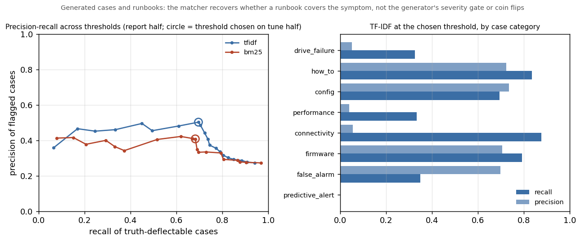

# services-ops-intelligence

Project 1 of 3: predictive support and parts forecasting for an installed
base of hardware, built the way a Services Operations team would use it.

## Why this exists

Enterprise AI data platforms settled on one diagnosis in 2026: the model is
rarely the next constraint, the data is. Their answer is a data layer that
engines and agents share, a knowledge graph built from metadata, lineage and
query history, and knowledge agents that get trusted, permissioned context
instead of raw tables. This is the data-science end of a three-part portfolio
built on that idea. The enterprise is small and its systems disagree the way
real ones do, but the hardware telemetry underneath is real, and the models
return an operations decision, not an accuracy score.

The three repositories:

1. `services-ops-intelligence` (this one): the shared data foundation and the
   Services Operations analyses.
2. [`enterprise-knowledge-graph`](https://github.com/arnavchawla26/enterprise-knowledge-graph) (v0.1): ontology, entity resolution,
   lineage graph and text-to-Cypher over the same enterprise.
3. [`knowledge-agents-pilot`](https://github.com/arnavchawla26/knowledge-agents-pilot) (v0.1): governed agents on NVIDIA Auto
   Ontology, Elasticsearch and MCP, with evaluations and program artifacts.

## What is real and what is generated

| Data | Source | Status |
|---|---|---|
| `telemetry_daily` (one row per drive per day: SMART attributes, failure flag, datacenter, vault, pod) | Backblaze Hard Drive Data, 2026 Q2, loaded as-is | Real |
| `drive_model`, `telemetry_drive_summary` | Derived from the telemetry by `sois.load_telemetry` | Real (derived) |
| `account`, `site`, `contact` (CRM) | `sois.generate_enterprise`, seeded | Generated |
| `product`, `order`, `order_line`, `installed_asset` (ERP) | same; `installed_asset.serial_number` is the real drive serial, so every asset is a real drive with real telemetry | Generated, joined to real |
| `part`, `supplier`, `part_supplier`, `inventory` (supply chain) | same | Generated |
| `case`, `dispatch`, `dispatch_part`, `technician`, `runbook` (support) | same; case timing is tied to real failure dates (cases cluster after a drive's failure flag, some open before it) | Generated, timed by real failures |
| `data_product`, `job`, `lineage`, `query_log` (metadata) | same | Generated |
| `truth/` | ground truth behind every piece of generated mess | Generated |

The generated data is dirty on purpose (three spellings of the same customer,
duplicate ids, two date formats, two definitions of "failure", null
warranties, vendor-prefixed serials). [docs/MESS_RULES.md](docs/MESS_RULES.md)
lists each rule and [docs/GENERATOR.md](docs/GENERATOR.md) shows how each
table is built. Each rule has ground truth under `truth/`, so any answer can
be checked. The generator is seeded. The same seed gives byte-identical
output, and `truth/generator_manifest.json` carries the hashes.

Generated data is acceptable here because a hiring manager cares that the
problem shape matches theirs, and known ground truth makes honest evaluation
possible. The telemetry the failure model learns from is real.

## Results (v0.2, measured 2026-10-17)

`make analyses` printed every number below, and `reports/` holds its output.
The memo for an operations reader is [docs/memo.md](docs/memo.md).

### 30-day failure risk as a dispatch-budget decision (real telemetry)

`sois.failure_model`. The label is `failure = 1` on any day in (t, t + 30].
Features use only days <= t. The time split leaks no labels: training
predicts on 2026-04-08 to 2026-04-24 (labels through 05-24), testing on
2026-05-25 to 2026-05-31 (labels through 06-30), so no test label was ever a
training label. Nothing was tuned on the test window. Negatives in the fit
rows are downsampled to 10%. 20% of drives are held out of the fit and
calibrate the probabilities (Platt) on the last five training dates. Test:
2,469,958 drive-days, 2,123 positive drive-days, 404 distinct failing drives.

| Ranking | PR-AUC | Recall in top 0.1% | Recall in top 1% | Brier (calibrated) |
|---|---:|---:|---:|---:|
| Backblaze rule (any of SMART 5/187/188/197/198 > 0) | 0.018 | 7% | 30% | n/a |
| Logistic regression | 0.057 | 15% | 44% | 0.000913 |
| LightGBM | 0.099 | 21% | 50% | 0.000816 |

The base rate is 0.00086 (a random ranking scores PR-AUC 0.0009). A constant
predictor scores Brier 0.000859, so the calibrated LightGBM beats it only
slightly, and the reliability table (`reports/reliability.csv`) shows the top
decile predicting 0.81% against an observed 0.61%. Calibration rests on 415
events and the test on 404 failing drives, so expect these numbers to move by
a few points with a different window.

Dispatch budget on the test window (per day, mean over 7 days). About 303
drives a day are within 30 days of failing. Full table in
`reports/dispatch_budget.csv`.

| Trucks per day | Rule caught | Rule for nothing | Logistic caught | LightGBM caught | LightGBM for nothing | LightGBM recall |
|---:|---:|---:|---:|---:|---:|---:|
| 10 | 0.1 | 9.9 | 2.9 | 5.6 | 4.4 | 1.8% |
| 25 | 1.1 | 23.9 | 6.1 | 10.6 | 14.4 | 3.5% |
| 50 | 2.4 | 47.6 | 8.9 | 16.9 | 33.1 | 5.6% |
| 100 | 7.9 | 92.1 | 19.3 | 27.9 | 72.1 | 9.2% |
| 250 | 20.4 | 229.6 | 35.1 | 50.6 | 199.4 | 16.7% |


The rule flags 29,930 drives a day (8.5% of the fleet). Dispatching to all of
them would catch 67% of failures at 0.7% precision. At any budget an
operation could run, the model catches several times what the rule catches,
and still under 10% of the month's failures with 100 trucks a day, because
most failures show nothing in the counters first. Top features by gain: 7-day
max of SMART 197, sectors waiting to be remapped (46%), reallocated sectors,
drive model, power-on hours.

### Parts demand forecast (generated dispatches)

`sois.parts_forecast`. Weekly units per region and part from `dispatch_part`.
13 weeks exist, so the backtest is weekly (rolling origin over the last 6
weeks, horizon 1), not monthly as first planned. MAE per region x part series
(mean week 1.2 units): naive 0.84, 4-week average 0.79, exponential smoothing
0.73, pooled LightGBM 0.68 (bias -0.17). Summed to fleet totals per part:
naive 2.37, SES 2.00, LightGBM 2.15. The demand is generated, so this proves
the pipeline and the comparison, not the demand.

### Repeat dispatches (generated support tables)

`sois.repeat_dispatch`. Repeat means visit 2 or 3 on the same case, or a first
visit within 30 days of a previous dispatched case closing on the same asset.
4,108 dispatches, 1,138 repeats (27.7%: 1,001 same-case, 137 cross-case).
Against `truth/dispatch_truth.csv`, 472 are necessary and 666 avoidable. The
same-case definition matches the truth flag on every row. The rates reproduce
the generator's rules (docs/GENERATOR.md). They are not a finding about any
real operation.

### Case deflection candidates (generated cases and runbooks)

`sois.case_deflection`. I match each case description against the 22
runbooks (title, symptoms, steps) with TF-IDF cosine (unigrams and bigrams,
scikit-learn) and, independently, Okapi BM25 (my own implementation).
Only runbooks of the case's product family are eligible. A case is a
candidate when its best match clears a threshold. The threshold maximises F1
on one half of the 8,281 cases (seeded split). The numbers below are from the
other half (4,200 cases, 1,158 deflectable per `truth/case_truth.csv`), and
swapping the halves moves them by about a point.

| Variant | Flagged | Precision | Recall | F1 |
|---|---:|---:|---:|---:|
| TF-IDF, family-restricted | 1,604 | 50% | 70% | 0.58 |
| BM25, family-restricted | 1,936 | 41% | 68% | 0.51 |
| TF-IDF + severity >= 3 (policy rule) | 1,122 | 69% | 67% | 0.68 |
| TF-IDF, every runbook eligible | 3,347 | 33% | 97% | 0.50 |



What this proves. The cases and runbooks are generated. The generator sets
`deflectable` first, from category, severity and coin flips (how_to, config,
firmware at severity 3 or 4 with a matched runbook: 85%; false_alarm: 60%;
everything else: 3%), and only then copies one of the runbook's symptom
phrases into the description. Non-deflectable cases carry a stock phrase that
is also the first symptom of a runbook in their category. So the text tells a
matcher whether a runbook covers the symptom, which is the generator's
precondition, and nothing about the severity gate or the coins. No text
matcher can score well on drive-failure, performance or connectivity cases
(a runbook exists, the fault is real). On how_to, config and firmware the
matcher is at 70% to 74% precision and 69% to 83% recall. With every runbook
eligible its top runbook is the generator's for 98% of deflectable cases
(BM25 86%), so the matching works. The family restriction costs recall
(97% to 70%) because the generator links a case to another family's runbook
when its own family has none for that category. Full tables:
`reports/case_deflection_metrics.json`, `reports/case_deflection_pr_table.csv`,
per-case scores in `reports/case_deflection.csv`.

### Dashboard, memo, Colab

`make dashboard` runs the Streamlit app over `reports/` only (no data needed).


- Memo for an operations leader: [docs/memo.md](docs/memo.md).
- The Colab notebook runs the feature pipeline in pandas and `cudf.pandas`:
  [open in Colab](https://colab.research.google.com/github/arnavchawla26/services-ops-intelligence/blob/main/notebooks/feature_pipeline_cudf.ipynb),
  steps in [docs/COLAB.md](docs/COLAB.md). On a Colab T4 (30 days, 10.4M rows) the feature step ran 5.1x faster on cudf.pandas (0.79 s vs 4.06 s), end to end 1.03x because CSV reading dominates. Table and caveats in docs/COLAB.md.

## Analyses

- The 30-day failure model has a leak-free time split, calibrated
  probabilities, dispatch-budget table and chart.
- The parts demand forecast by region and part is backtested weekly (not
  monthly: 13 weeks of data) against naive, moving-average and smoothing
  baselines.
- Repeat dispatches by product, category, region, technician and supplier are
  checked against the truth flags.
- Case deflection candidates come from a TF-IDF and BM25 runbook match scored
  against `truth/case_truth.csv`, with the threshold chosen on a held-out half.
- The Streamlit dashboard has five pages. One two-page memo covers all four
  analyses, not one each.
- The Colab cuDF notebook ran on a T4 on 2026-10-17 (5.1x on the feature step, 1.03x end to end; see docs/COLAB.md).

## Scope

Each Project 1 item from the design notes, done with its file or cut with
the reason.

| Item | Status | Where / why |
|---|---|---|
| 30-day failure model, calibrated, as a dispatch-budget decision | Done | `src/sois/failure_model.py`, `reports/dispatch_budget*.{csv,png}`, `reports/failure_model_metrics.json` |
| Parts demand forecast by region and part with backtests and a naive baseline | Done (weekly, not monthly) | `src/sois/parts_forecast.py`, `reports/parts_forecast*`. 13 weeks of data allow only a weekly rolling-origin backtest |
| Repeat-dispatch analysis by case type, product, region | Done | `src/sois/repeat_dispatch.py`, `reports/repeat_dispatch*` |
| Case deflection candidates from case text vs runbooks | Done | `src/sois/case_deflection.py`, `reports/case_deflection*` |
| Leader-facing dashboard (Power BI or Streamlit) | Done, Streamlit | `app/dashboard.py`, `reports/dashboard.png`. Streamlit is code a reviewer can read and run from a clone |
| Power BI screenshot | Cut | Power BI is not used here. A screenshot of a second tool over the same `reports/` files would show nothing the Streamlit page does not, and the Streamlit code is what a reviewer can run |
| Two-page memo per analysis | Done as one memo | `docs/memo.md` covers all four analyses in two pages. Four memos would repeat the data and caveat sections |
| Colab notebook with cudf.pandas timings | Done | `notebooks/feature_pipeline_cudf.ipynb`, `docs/COLAB.md`, T4 timings in the notebook outputs |
| Survival analysis (lifelines, time to failure by model and vendor) | Cut | 91 days of telemetry is too short for survival curves on drives that run for years, and the 30-day classifier is the decision the ops lead asked for. With a year of data this is the first thing to add |
| Anomaly detection on fleet telemetry | Cut | Listed in the earlier Project A sketch the notes folded into this project. The telemetry has failure labels, so an unsupervised detector would be scored against the same labels as the classifier with less information. It earns its place on telemetry without labels (fans, PSUs), which this quarter does not have |

## What exists today

- `scripts/download_backblaze.sh` fetches, verifies and extracts the 2026 Q2
  data.
- `src/sois/load_telemetry.py` loads the daily CSVs into partitioned Parquet
  with DuckDB, plus per-drive and per-model summaries, and handles SMART
  columns that come and go between files.
- `src/sois/generate_enterprise.py` generates the seeded enterprise and its
  ground truth.
- `docker-compose.yml`, `sql/schema.sql` and `src/sois/load_postgres.py` load
  Postgres 16 with the generated tables, the drive summary, and the last 30
  days of daily telemetry (the full quarter stays in Parquet).
- `src/sois/failure_model.py`, `parts_forecast.py`, `repeat_dispatch.py` and
  `case_deflection.py` are the four analyses, each a CLI writing to `reports/`
  (`make models`, `make parts`, `make repeat`, `make deflection`). The failure
  model reads the Parquet with DuckDB one prediction date at a time and runs
  in about 30 seconds on a laptop.
- `app/dashboard.py` is the dashboard, `scripts/screenshot_dashboard.py` its
  headless screenshot.
- `tests/` holds 45 tests on hand-made synthetic fixtures covering loader
  counts and schema drift, generator determinism and every mess rule, the DDL,
  a live Postgres load when `SOIS_TEST_DSN` is set, and for the analyses that
  features use only days <= t, labels match the window, the split refuses a
  leaking configuration, budget arithmetic, mixed-format timestamp parsing,
  the repeat definitions, BM25 ranking, the family restriction, threshold
  choice, and end-to-end runs on synthetic fleets and cases.

## Setup

You need Python 3.13, [uv](https://docs.astral.sh/uv/), Docker (for
Postgres) and about 15 GB of disk for the raw data. The analyses need the
Parquet and the generated tables. The dashboard and the tests do not.

```
uv sync                                  # environment from uv.lock (pinned)
uv run pytest                            # fixture-only, no data needed
bash scripts/download_backblaze.sh       # asks before fetching 2.1 GB
make load                                # CSV -> data/parquet (DuckDB)
make generate                            # enterprise tables -> data/enterprise, truth/
cp .env.example .env && make db-up       # Postgres 16 in Docker
make postgres                            # schema + load
make analyses                            # failure model, parts backtest, repeat dispatch, case deflection -> reports/
make dashboard                           # Streamlit over reports/ (works from a fresh clone)
```

LightGBM on macOS needs OpenMP (`brew install libomp`). The dashboard
screenshot (`make screenshot`) uses Playwright with the machine's Chrome, or
`uv run playwright install chromium` once.

`make load` on the full quarter reads about 11.7 GB of CSV, so expect minutes,
not seconds. `make postgres` copies roughly 30 days x all drives of daily rows
into Postgres (`--telemetry-days` to change).

## The telemetry

Backblaze publishes daily SMART snapshots for every drive in its data centers.
Per Backblaze's own page, 2026 Q2 is 2.1 GB zipped, 11.7 GB on disk, 354,415
drives, 1,498 failures and 31.5 million drive-days. `make load` on 2026-10-17
counted 31,968,003 drive-days across 91 days (2026-04-01 to 2026-06-30),
359,101 distinct serial numbers, 1,522 failure rows and 81 drive models
(`data/parquet/load_summary.json`). My drive count is higher than Backblaze's
because it counts every serial seen at any point in the quarter, including
drives replaced mid-quarter. Columns: `date, serial_number, model, capacity_bytes, failure,
datacenter, cluster_id, vault_id, pod_id, pod_slot_num, is_legacy_format`,
then `smart_N_normalized` / `smart_N_raw` pairs. The loader keeps attributes
1, 3, 4, 5, 7, 9, 10, 12, 187, 188, 190, 192, 193, 194, 196, 197, 198, 199,
240, 241, 242 (the five Backblaze found most predictive are 5, 187, 188, 197,
198). `failure = 1` marks the last day a drive reported before it was pulled.

The Backblaze Hard Drive Data is free to download and use. Their terms ask
that you cite Backblaze as the source. They allow selling derivative work
(this code and its results) and do not allow selling the data itself.
Source: https://www.backblaze.com/cloud-storage/resources/hard-drive-test-data

## Results page

`site/` is a static page of the results in this README, built by `scripts/build_site.py` from `reports/` and `docs/`. The script writes `site/data/*.json` and `site/img/*`; `site/index.html`, `app.js` and `style.css` are hand-written and read those files. `vercel.json` serves the folder as-is, so nothing is computed at request time. Rebuild the page after regenerating reports.

## Layout

```
scripts/      download_backblaze.sh, render_schema.py, screenshot_dashboard.py
src/sois/     load_telemetry.py, generate_enterprise.py, load_postgres.py,
              failure_model.py, parts_forecast.py, repeat_dispatch.py,
              case_deflection.py
app/          dashboard.py (Streamlit, reads reports/ only)
notebooks/    feature_pipeline_cudf.ipynb (Colab, pandas vs cudf.pandas)
reports/      small CSV/JSON/PNG outputs of the analyses (committed)
models/       trained models and full drive-day scores (gitignored)
sql/          schema.sql (rendered; Postgres 16 and DuckDB compatible)
docs/         MESS_RULES.md, GENERATOR.md, memo.md, COLAB.md
truth/        ground truth (regenerated by `make generate`; manifest committed)
tests/        pytest suite and the synthetic fixtures
data/         raw/ (downloads, untrusted), parquet/, enterprise/  (all gitignored)
```

## Honesty

Commit dates are real. Nothing is backdated. The generated data is labelled
as generated everywhere it appears. Its generator is in this repository and
its ground truth is reproducible from the committed seed. No analysis result
is claimed in this README until the code that produced it is in the
repository with the numbers it printed.

## License

MIT, see [LICENSE](LICENSE). The Backblaze data is subject to Backblaze's
terms, not this license.
